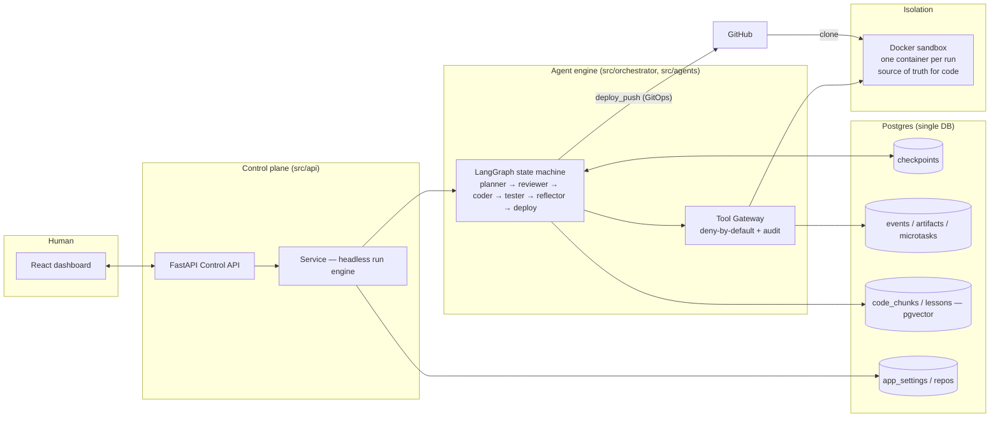
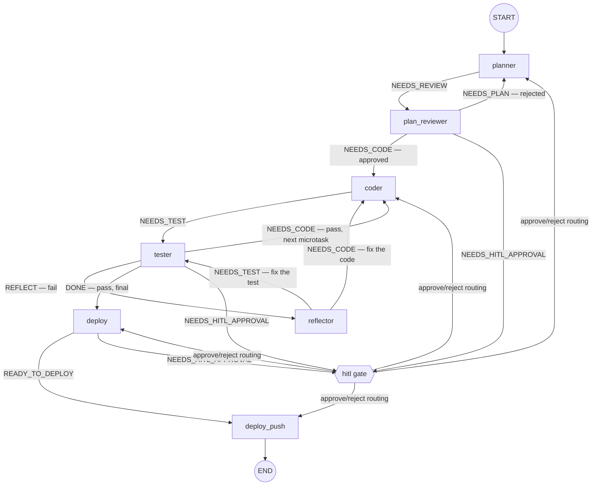

# AgenticDevOps — As-Built Architecture

> **What this document is.** The implemented architecture as it exists today
> (2026-07-14). Unlike `ARCHITECTURE_preview.md` (the original design spec / plan) this
> describes only what is actually running. If you are reading this years from now:
> `CLAUDE.md` holds the fast-changing status tables, `docs/decisions/` (ADRs) holds the
> *why* behind every non-obvious choice, and `docs/problems-log.md` holds what broke and
> how it was fixed. This file is the stable foundation between them.

---

## 1. What the system is

AgenticDevOps is a **multi-agent system (MAS)** that autonomously plans, implements,
tests, and proposes code changes (branches + pull requests) to an existing GitHub
repository. A human gives it an objective ("add feature X to repo Y"); the system
investigates the repo, produces a reviewed plan of microtasks, writes the code in an
isolated Docker sandbox, verifies it with deterministic checks, and — after optional
human approval — pushes a branch and opens a PR.

Four properties are the yardstick for every design decision:

| Property | How it is achieved |
|---|---|
| **Auditability** | Every decision, tool call, and state change lands in Postgres (events, artifacts, checkpoints). Nothing important lives only in memory. |
| **Safety** | Deny-by-default Tool Gateway, per-role allowlists, Docker-per-run sandboxing, secret scanning before any push, default-branch pushes refused. |
| **Reproducibility** | The entire run state is checkpointed by LangGraph after every superstep. A crashed run resumes from its last checkpoint; nothing is re-derived from scratch. |
| **Human-in-the-loop** | Configurable approval gates (plan / code / deploy) suspend the graph mid-flight and wait for an explicit human decision. |

---

## 2. System overview

The stack: **Python + LangGraph** for the agent state machine, **Postgres (+ pgvector)**
as the single persistence layer, **Docker** for per-run isolation, **FastAPI** as the
control plane, **React** (`dashboard/`) as the UI. LLM providers are pluggable
(OpenAI-compatible endpoints and Anthropic), selected per agent via UI-managed settings.

---

## 3. Core architectural decisions

These are the load-bearing choices. Each has an ADR with full reasoning.

### 3.1 Blackboard state machine (star topology)

All agents communicate through a single shared state — the **blackboard**
(`orchestrator/state.py::BlackboardState`) — owned exclusively by the Orchestrator.
Agents never call each other and never mutate state in place: each graph node returns a
dict of *changed keys only*, and LangGraph merges it. Routing between agents is driven by
one field, `status: RunStatus` — the blackboard's phase transitions ARE the protocol
(e.g. `NEEDS_REVIEW` → reviewer, `NEEDS_CODE` → coder, `REFLECT` → reflector).

Why: a star topology with a single state owner makes every inter-agent hand-off visible,
checkpointable, and replayable. There is no hidden agent-to-agent channel to audit.

### 3.2 Checkpointing, not snapshots (ADR 0005)

Run state persistence is delegated to **LangGraph's PostgresSaver**: after every
superstep the full blackboard is checkpointed to the `checkpoints` tables, keyed by
`thread_id = run_id`. A hand-rolled `run_state` snapshot table existed in the original
design and was deliberately replaced. Consequences:

- A crash mid-run leaves the run **STALLED** (resumable), never lost.
- HITL gates are a *mid-graph suspend* (`interrupt()`), not a process exit — resume
  continues from the exact node, sandbox intact.
- The checkpointer runs on a psycopg **connection pool** (ADR 0032), so multiple runs
  execute concurrently, each superstep borrowing its own connection.

### 3.3 Bootstrap runs OUTSIDE the graph (ADR 0005)

`BootStrapper` (`orchestrator/bootstrap_node.py`) is *not* a graph node. LangGraph
resumes from the last completed node — a bootstrap node would be skipped on every
resume. Instead the run driver calls it directly before every `graph.invoke()`. It is
idempotent: upsert the Run row, ensure the sandbox container is running, clone the repo
on first run, ingest the semantic baseline. The graph itself starts unconditionally at
`planner`.

### 3.4 Tool Gateway — deny by default (ADR 0009)

Every environment action by an LLM agent (file read/write, shell exec, diff, semantic
search) goes through `tool_gateway/gateway.py::ToolGateway`:

1. **Role allowlist** — each role (`Roles.py`) has a `RolePermissions` subclass
   (`permissions.py`) declaring which tools it may call *and* which sandbox commands
   (argv[0]) it may run. E.g. the Coder is gateway-blocked from running `pytest` — not
   just prompt-forbidden.
2. **Audit** — every call emits `tool.executed` or `tool.denied` into the `events`
   table via `EventLogger` (which only ever `session.add()`s — commit ownership stays
   with the caller's `session_scope()`, ADR 0003).
3. Shell commands must be argv lists (no shell string injection surface).

One deliberate exception: **GitOps and the Control API are not LLM agents** and bypass
the gateway (ADR 0012/0013). The gateway protects against *agent* misbehaviour;
deterministic system code is trusted and audited via events instead.

### 3.5 Docker-per-run sandbox — the source of truth for code

Each run gets its own container (image `agentic-sandbox:0.1`), created by bootstrap,
tracked in the `sandboxes` DB table (survives process restarts — no in-memory registry).
All agent file operations and command executions happen inside it
(`sandbox/sandbox_tools.py`, pure `docker exec` — no remote git from inside). The
sandbox **is** the code during a run: semantic memory is retrieval-only and never used
to reconstruct files. Teardown on terminal states is a setting
(`defaults.teardown_on_terminal`); stalled runs always keep their container so they can
be continued (ADR 0021).

### 3.6 Grounded verification — no LLM-only acceptance

Code is accepted only when **deterministic checks pass**. The Tester's verdict comes
from real exit codes (existing suite, build, typecheck, synthesized tests), never from
an LLM opinion of the diff. Layers of grounding (ADR 0015/0016/0022):

- **Track A**: run the repo's existing suite + config-gated build/typecheck/lint.
  A pre-existing red suite is baselined (`suite_baseline_failures`) — only *new*
  failures beyond the baseline fail a microtask.
- **Track B**: tests are synthesized from the **Planner's** `acceptance_criteria`
  (structured `AcceptanceCriterion` + concrete `IOExample`s) — independent of the
  Coder, so the Coder cannot write its own passing test. A deterministic AST/regex
  guard rejects tautological assertions; without a planner-supplied I/O example the
  synthesizer may assert structure only, never a self-computed value.
- The Coder has its own pre-tester **compile gate** (`py_compile` / `node --check`).

### 3.7 GitHub boundary in one class (ADR 0012)

`gitops/gitops.py::GitOps` is the only code that talks to remote git: clone (honours
`base_ref`), push, PR creation. Hard safety rails: the repo's **default branch is
refused as a push target at four layers**; push target resolves per-run
(`push_branch` › registry override › `agent/run-<run_id>`, ADR 0035); **gitleaks scans
the tree before every push and hard-blocks on any finding** (run → FAILED, ADR 0019);
dependency dirs / secrets / synthesized tests are excluded from staging by pathspec.
PR creation is optional per-run and *degrades* on failure — a failed PR never fails a
run whose push succeeded (ADR 0027).

---

## 4. The agent graph

Defined in `orchestrator/orchestrator.py::OrchestratorGraph` — the whole state machine
reads top-to-bottom in one file. Eight nodes; all edges are conditional on `status`.

### Node responsibilities

| Node | Role | Contract (in → out) |
|---|---|---|
| **planner** (`agents/Planning/Planner/`) | Investigates the repo with read-only ReAct tools (file reads, semantic search), then synthesizes a `Plan` + ordered `Microtask[]` with acceptance criteria. A deterministic quality gate (`quality.py`) rejects bad microtasks; synthesis retries with the validation error fed back. | objective → `plan`, `microtasks`, status `NEEDS_REVIEW` |
| **plan_reviewer** (`agents/Planning/Reviewer/`) | Independent critic (actor-critic pattern, ADR 0011). Investigates on its own read-only tools, then emits a structured approve/reject. The planner sees only the **latest** verdict + structured `blockers` (ADR 0022 — prevents feedback-stack divergence). | plan → `NEEDS_CODE` (approve) / `NEEDS_PLAN` (revise) |
| **coder** (`agents/Implementing/Coder/`) | One microtask at a time. Hybrid grounding: the runner pre-reads target/context files into the prompt; a single ReAct loop edits files through the gateway; **deterministic `repo.diff` verifies work actually happened** (empty diff → re-prompt); compile gate before hand-off. | microtask → sandbox edits, status `NEEDS_TEST` |
| **tester** (`agents/Implementing/Tester/`) | Phase pipeline (detect → deterministic checks → synthesis → trivial-guard → execute → verdict), ADR 0016. **Owns the PASS/FAIL verdict** — deterministic, from exit codes. PASS → microtask COMPLETED, `NEEDS_CODE` (more work) or `DONE` (final). FAIL → `REFLECT`. | code → verdict + evidence (`Checks`) |
| **reflector** (`agents/Implementing/`) | **Failure-only** (ADR 0016) — never runs on green, never approves. Diagnoses the failure from real test output artifacts, seeds a `Reflection` (root cause + fix instructions), and routes by `fix_target`: `code` → coder retry, `test` → tester re-synthesizes a wrong test (bounded by `REFLECTOR_MAX_TEST_RESYNTH`). | failure evidence → `Reflection`, `NEEDS_CODE`/`NEEDS_TEST` |
| **deploy** | Not an agent — a *gate producer*. Emits `READY_TO_DEPLOY` and funnels through the shared HITL gate. | — |
| **deploy_push** | Not an agent — drives `GitOps` (stage → secret-scan → commit → push → optional PR), then `DONE`. Bypasses the Tool Gateway deliberately. | sandbox → branch on GitHub |
| **hitl** | Shared suspension point — `interrupt()` until a human decision arrives. | see §5 |

### Routing rules worth remembering

- Routers **never** have side effects and never write the DB — nodes do both. Routers
  only read `status` (`_status_gate` pattern: each edge has an allowlist of expected
  statuses; anything else halts at END rather than advancing on an inconsistent status).
- **Loop caps are enforced in nodes, not routers**: planner↔reviewer capped by
  `Constraints.max_planner_reviewer_iterations` (reviewer node → FAILED, ADR 0031);
  coder↔tester↔reflector capped **per-microtask** by `max_microtask_attempts` (coder
  node → FAILED). A run-wide cycle cap was considered and rejected — with a fixed plan,
  the per-microtask cap already bounds total work (ADR 0031).
- `skip_deploy` (dry-run, ADR 0029): the run ends at DONE without pushing.
- Every node's first line is `_check_stop()` — cooperative stop points so a human
  Stop request (ADR 0033) bounds the run to at most one in-flight node.

---

## 5. Human-in-the-loop gates

One mechanism (`orchestrator/hitl.py::HitlGate` + the shared `hitl` node), three gates,
configured per-run via `hitl.hitl_checkpoints` (empty list = fully autonomous). When a
gated phase advances, `HitlGate.apply` rewrites its status to `NEEDS_HITL_APPROVAL` and
records a `PendingApproval` (carrying the original `forward_status`); the graph suspends
via LangGraph's native `interrupt()` (ADR 0006).

| Gate | Fires after | Approve → | Reject (note **required**) → |
|---|---|---|---|
| `plan` | reviewer approves a plan | coder | planner (note becomes `ReviewFeedback`) |
| `code` | tester **passes** a microtask | next microtask / deploy | microtask reset to IN_PROGRESS + note seeded as a `Reflection` for the coder |
| `deploy` | final microtask passes | `deploy_push` (approve payload may override the commit message) | END — run finishes un-deployed |

A reject without a note re-interrupts (stays paused) — un-actionable input never routes.
A `code` reject deliberately skips the reflector: the human note *is* the diagnosis.

Resume is an API call (`POST /runs/{id}/resume` → `Command(resume=HitlResume)`), which
advances the graph exactly one gate. Because the pause is a mid-graph suspend in a live
process, resume does **not** re-bootstrap — sandbox and checkpoint are intact.

---

## 6. Memory model

Four distinct memories, deliberately separated:

| Memory | Storage | Lifetime | Purpose |
|---|---|---|---|
| **Working state** (blackboard) | `checkpoints` (LangGraph) | per run | The live state machine — plan, microtasks, evidence, reflections, iteration counters. |
| **Episodic** | `events`, `artifacts`, `microtasks`, `runs` | forever | The audit trail: what happened, when, by whom. `events.seq` (BIGSERIAL) is the dashboard's replay cursor. |
| **Semantic (code)** — Context Engine (ADR 0010) | `code_chunks` (pgvector, 384-dim MiniLM) | baseline: per repo+SHA; workspace: per run | Retrieval-only semantic search over AST chunks (tree-sitter). `baseline` namespace ingested at bootstrap; `workspace` synced after each coder diff; purged on teardown. Never used to reconstruct code — the sandbox is the truth. |
| **Lessons** (ADR 0018/0034) | `lessons` (pgvector) | per repo, cross-run | Failure memory written only on **confirmation** (reviewer approve / tester pass), retrieved top-k semantically into planner/reviewer/coder/reflector prompts (advisory). **Operator rules** (`agent="human"`) are human-typed in the dashboard, always injected unranked (never lose a top-k race), capped at the newest 15 per scope. Human-touched lessons are immune to retraction. |

---

## 7. Control plane and observability

### Control API (`src/api/`, ADR 0013)

FastAPI app — the dashboard's only backend, and *not a second engine*: it drives the
same checkpointed graph. `Service` (`service/service.py`) is the headless run engine:

- `POST /runs` — validates the request, **preflights** the LLM provider
  (health-check) and GitHub push/PR rights (ADR 0029) *before* creating anything
  (4xx = no run), resolves one immutable `RunConfig` onto the blackboard, then drives
  the graph in a background worker to the first gate or END.
- One `graph.invoke()` per gate; `POST /runs/{id}/resume` advances exactly one.
- Run lifecycle controls: `/stop` (cooperative hard-stop, ADR 0033), `/continue`
  (recover a STALLED run, optionally raising the token budget), `/fail` (close it),
  `DELETE` (terminal runs only).
- Repo registry CRUD (`/repos`, ADR 0024) with per-repo encrypted tokens, and the
  lesson store endpoints (ADR 0034).

### Two log feeds, by purpose (ADR 0013)

- **Live** — structlog is tee'd into an in-memory per-run ring buffer
  (`observability/log_bus.py`) and streamed over SSE (`/runs/{id}/logs/stream`).
  Ephemeral, granular (node enters, tool steps). Gone on restart, by design.
- **Durable** — the `events` table, polled by `seq` cursor. The permanent record.

Right-sized to the deployment: self-hosted, single user, localhost. No message broker,
no LISTEN/NOTIFY, no resumable-SSE machinery — deliberately (see ADR 0013).

### Failure semantics

| Terminal-ish state | Meaning | Recovery |
|---|---|---|
| `FAILED` | A hard policy/limit violation (loop cap, secret found, microtask attempts exhausted) | none — terminal |
| `STALLED` | Transient LLM error, crash, or **token budget exceeded** (`TokenBudgetExceededError`, ADR 0025) | `POST /continue` (with `additional_tokens` for a budget stall) — checkpoint + sandbox intact |
| `STOPPED` | Human hard-stop (ADR 0033) | none — terminal |
| `DONE` | Completed (deployed, dry-run, or deploy rejected) | — |

Uncaught crashes are never silently FAILED — they stall, because a checkpointed run is
recoverable and throwing away paid-for progress is the worse default.

---

## 8. Configuration: the settings hub (ADR 0020/0030)

All tuning lives in one UI-managed DB row (`app_settings`); `.env` values are only
first-boot seeds. Key design points:

- **Per-agent model selection** (`LLMConfig`): each of the five agents carries its own
  `provider_id` + `model` — cheap models for investigation, a strong one for the Coder.
  Providers are `ProviderProfile`s (OpenAI-compatible or Anthropic), constructed in one
  place: `providers/llm.py::build_chat_llm`.
- **Resolve once, carry on state**: a run resolves one `RunConfig` (per-run override ›
  DB › env seed) at creation and stores it on the blackboard. Agents take `config` as a
  mandatory argument; the `or resolve_run_config()` fallback lives only at the node
  boundary. Mid-run settings changes never alter a live run.
- **Secrets** (provider keys, GitHub token, per-repo tokens) are masked on read and
  Fernet-encrypted at rest (`db/secrets.py`, ADR 0021).
- **Budgets**: `Constraints.max_total_tokens` is checked at the top of every node
  (`orchestrator/token_budget.py`); real usage is captured per LLM call
  (`providers/token_usage.py`) into `llm.usage` events and the checkpointed running
  total (ADR 0025).

---

## 9. Database schema (one Postgres, everything)

| Table | What it holds |
|---|---|
| `runs` | One row per run: status, repo, task, token totals (denormalized mirrors for cheap dashboard queries). |
| `checkpoints*` | LangGraph PostgresSaver — full blackboard per superstep. |
| `events` | Append-only audit trail with monotonic `seq`. |
| `artifacts` | Plans, diffs, test logs, reflections — content-addressed by kind + microtask. |
| `microtasks` | Planner output, persisted after each plan. |
| `sandboxes` | run → Docker container id mapping. |
| `code_chunks` | Context Engine vectors (pgvector). |
| `lessons` | Cross-run failure memory + human operator rules (pgvector). |
| `repos` | Repo registry: canonical URL (the memory key), per-repo token, push override. |
| `app_settings` | The single settings blob. |

ORM is SQLAlchemy 2.0 style (`Mapped`/`mapped_column`); migrations via Alembic.

---

## 10. Anatomy of a run (end to end)

1. **Trigger** — dashboard `POST /runs` (repo from registry or raw URL, objective,
   constraints, gates). Provider + GitHub-rights preflights must pass first.
2. **Bootstrap** (outside the graph) — Run row upserted, sandbox container started,
   repo cloned at `base_ref`/`base_sha`, `.gitignore` seeded, semantic baseline
   ingested.
3. **Planning loop** — planner investigates + synthesizes; reviewer independently
   investigates + approves/rejects; loop capped. Optional `plan` gate.
4. **Execution loop** — per microtask: coder edits (diff-verified, compile-gated) →
   tester verdicts deterministically → on FAIL the reflector diagnoses and routes the
   retry; on PASS the optional `code` gate fires. Workspace vectors re-synced after
   each diff. Attempts capped per microtask.
5. **Deploy** — final PASS → optional `deploy` gate (human sees the full diff, can
   edit the commit message) → gitleaks scan → push to a non-default branch →
   optional auto-PR with a deterministically generated body.
6. **Terminal** — run `DONE`; sandbox torn down if configured; lessons already written
   at their confirmation points; everything queryable forever in Postgres.

At any point: crash/budget → STALLED (continuable); human stop → STOPPED; policy
violation → FAILED. All of it visible live (SSE logs) and forever (events timeline).

---

## 11. Known gaps (honest list, as of 2026-07-14)

- **Webhook trigger / CI relay / merge automation** — not built; trigger is
  dashboard/API only, and the PR is where automation currently ends.
- **`check_requested_path`** (sandbox path-traversal check in the gateway) is defined
  but not wired into `fs.read_file`/`fs.write_file`.
- **Redundant iteration counters** — `Iteration.global_iteration` /
  `global_iterations_used` are dead fields awaiting collapse.
- **`reflections` as a queryable table** — reflections live in checkpoints (crash-safe)
  and their durable cross-run value is served by `lessons`; a dedicated table remains
  optional.
- **Lesson hygiene** — no per-repo prune/cap yet on agent-written lessons.
- The legacy **CLI** (`src/main.py`) is being deleted in favour of the API.

The authoritative, always-current version of this list is the "Known bugs / remaining
TODOs" section of `CLAUDE.md`.

---

## 12. Reading map

| Question | Where |
|---|---|
| Why was X decided? | `docs/decisions/NNNN-*.md` (append-only ADRs) |
| What broke and how was it fixed? | `docs/problems-log.md` |
| What is the current status of component X? | `CLAUDE.md` status tables |
| Original design spec (pre-implementation) | `docs/ARCHITECTURE_preview.md`, `docs/Design_preview.md` |
| Blackboard schema + event registry | `docs/Blackboard.md` |
| Tool Gateway / permission contracts | `docs/MCP_AND_TOOLS.md` |
| The state machine, in code | `src/orchestrator/orchestrator.py` (reads top-to-bottom) |
